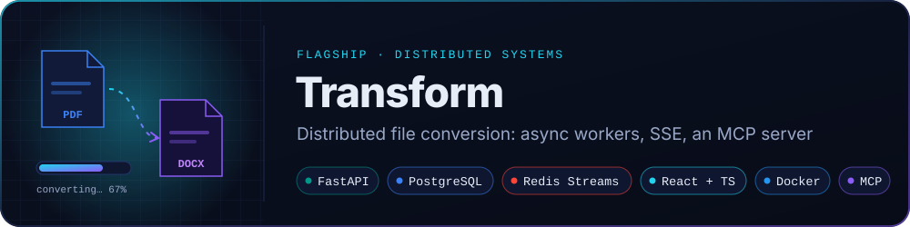
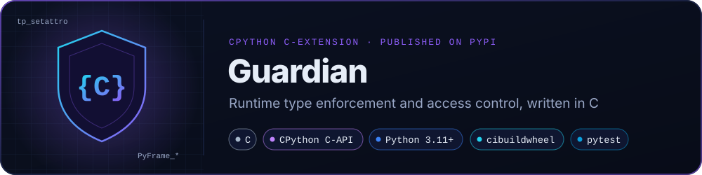
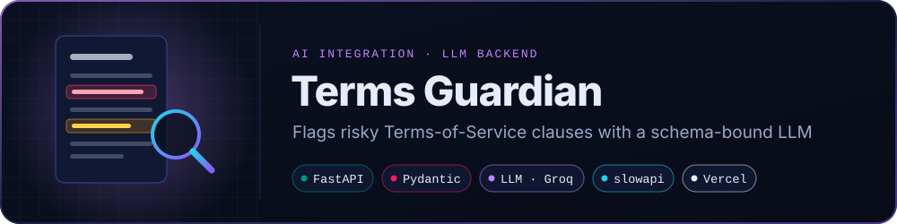
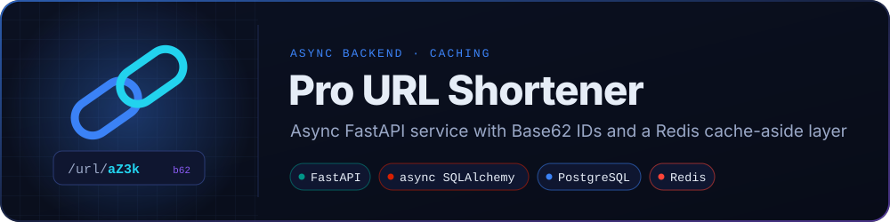
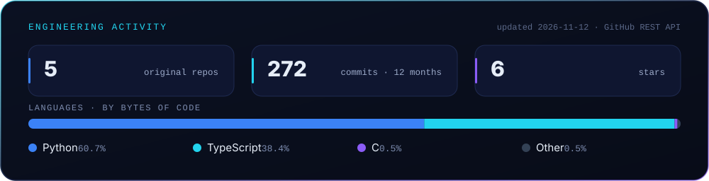

 

&nbsp;
&nbsp;
&nbsp;

 

**I like the parts of a system nobody notices until they break:** 
queues, retries, auth boundaries, and the layer between a Python API and the machine underneath it.

 

I'm a software engineer based in Charlottetown, PEI. Most of my work is backend: services that take a request, hand the slow part to a worker, and report back honestly about what happened. I care most about the edges. What happens when a worker dies halfway through a job? What does a forged token look like compared with an expired one? What should the app do if production config is unsafe?

A few habits show up in everything I build:

- **I write the plan before the code.** Larger features start as a design doc and an audit of what already exists, and they say plainly what is not finished yet.
- **I keep the domain separate from the frameworks.** Business rules live in plain Python. Databases, queues, payment providers and LLMs connect through ports and adapters, so I can swap them out and test them with fakes.
- **I go down a layer when it's worth it.** When runtime type checking in pure Python cost too much, I wrote the hot path as a CPython C-extension.
- **I build software that AI agents can use.** That means real interfaces with real authorization (OAuth, scoped tools, the same service layer the REST API uses), not a chatbot bolted onto the side.

> **Right now:** building *cloud workspaces* for Transform, which are persistent Python environments that agents can drive through MCP. The rule behind them: the runtime is disposable, the workspace is not.

 

<table>
  <tr>
    <td><b>Languages</b> Python · TypeScript · C · Java</td>
    <td>
      
      
      
      
    </td>
  </tr>
  <tr>
    <td><b>Backend &amp; APIs</b> async services, auth, payments</td>
    <td>
      
      
      
      
      
      
    </td>
  </tr>
  <tr>
    <td><b>Data &amp; messaging</b> storage, streams, caching</td>
    <td>
      
      
      
      
      
    </td>
  </tr>
  <tr>
    <td><b>AI &amp; agents</b> MCP servers, LLM APIs</td>
    <td>
      
      
    </td>
  </tr>
  <tr>
    <td><b>Frontend</b> typed SPAs</td>
    <td>
      
      
      
    </td>
  </tr>
  <tr>
    <td><b>Infra &amp; tooling</b> ship, test, observe</td>
    <td>
      
      
      
      
      
      
      
      
      
    </td>
  </tr>
</table>

 

A full file-conversion platform covering documents, images, audio, video, ebooks, fonts and archives. The API never does the heavy work. It validates the job, queues it, and streams progress back while separate workers do the conversion.

- **Layered with Domain-Driven Design:** `domain → application → infrastructure → presentation`, with 18 application ports. Queues, storage, payments, email, LLMs and container runtimes are all swappable adapters.
- **Reliable job processing:** Redis Streams consumer groups, retry with backoff, `XAUTOCLAIM` to recover messages stuck with a dead consumer, and a dead-letter stream for replaying failed jobs. Live progress reaches the browser over SSE.
- **Security built in from the start:** opt-in encryption at rest (chunked AES-256-GCM with per-user keys derived via HKDF), single-use verification tokens stored only as SHA-256 hashes, responses that don't reveal whether an account exists, and an app that refuses to boot with unsafe production config.
- **Usable by AI agents:** a remote MCP server with OAuth 2.1 + PKCE and dynamic client registration. It calls the *same* application services as the REST API, so no authorization rule is written twice.
- **Tested and gated:** 2,100+ pytest test functions, Vitest on the frontend, `pyrefly` type checking in CI, and deploys that only run after CI passes.

**Stack:** Python · FastAPI · SQLAlchemy 2 (async) · Alembic · PostgreSQL · Redis Streams · S3 (MinIO / Backblaze B2) · Stripe · React 18 · TypeScript · Vite · Tailwind · Docker · Prometheus 
**[Source →](https://github.com/Michex111/transform)** &nbsp;·&nbsp; **[Live →](https://transform-to.com)**

 

Runtime type checking usually costs a lot because it runs in Python. Guardian moves the checks into C. Type hints are compiled once into an internal form, and every later assignment or call is checked natively.

- **Hooks into CPython's attribute protocol:** a custom `tp_setattro` on the `Shield` base type checks the type of every attribute assignment, with no proxy objects or `__dict__` wrapping.
- **Access control by walking stack frames:** private `_attributes` are protected by walking the caller's frames in C. Frame locals are read through the mapping protocol, so it also works with PEP 667's `FrameLocalsProxy` on Python 3.13+.
- **Feels like normal Python:** `@guard`, `@deepguard`, and a drop-in `dataclass` with `@validator` hooks and `dataclass_transform`, so IDEs and type checkers understand it.
- **Released properly:** tag-triggered CI runs the tests, then builds wheels with `cibuildwheel` for Linux, macOS (x86_64 + arm64) and Windows, including free-threaded CPython 3.14, and publishes them to PyPI. Includes a benchmark harness comparing it with Pydantic v2 and Beartype.

**Stack:** C · CPython C-API · Python · pytest · cibuildwheel · GitHub Actions 
**[Source →](https://github.com/Michex111/guardian-type-enforcer)** &nbsp;·&nbsp; **[PyPI →](https://pypi.org/project/guardian-type-enforcer/)** &nbsp;·&nbsp; `pip install guardian-type-enforcer`

 

The analysis backend for a browser extension that highlights predatory clauses in Terms of Service and explains them in plain English. The interesting problem is making an LLM *behave like an API*.

- **Structured output:** the model is limited to a fixed set of clause types and risk indicators, with fixed scoring rules, and every response is validated against a Pydantic model.
- **Cheap and predictable:** documents are whitespace-normalised and hashed with SHA-256, so the same policy is never sent to the LLM twice within the cache window.
- **Fails safely:** if the model fails, the API still returns a schema-valid fallback, so the extension never breaks. Requests are rate-limited per IP and locked to the extension's origin.

**Stack:** Python · FastAPI · Pydantic · OpenAI-compatible SDK → Groq · slowapi · Vercel serverless 
**[Source →](https://github.com/Michex111/terms-ai)**

 

A small project with deliberate choices. Each short code is the Base62 encoding of the row's primary key, so codes can never collide and there are no random retries. Redirects go through a Redis cache-aside layer with a TTL, and submitting the same URL twice returns the existing code. It uses an async stack from the route down to the database session.

**Stack:** Python · FastAPI · async SQLAlchemy · PostgreSQL · Redis · Pydantic 
**[Source →](https://github.com/Michex111/Pro-URL-shortner)**

 

<picture>
  <source media="(prefers-color-scheme: dark)" srcset="assets/generated/snake-dark.svg" />
  <source media="(prefers-color-scheme: light)" srcset="assets/generated/snake-light.svg" />
  
</picture>

 

If you're working on backend infrastructure, developer tooling or agent-facing software, I'd like to hear about it. 
Open an issue on any of my repos, or find me here:

&nbsp;

 

Every visual on this page is a self-hosted SVG in <a href="assets"><code>assets/</code></a>. The activity card and snake are regenerated daily by <a href=".github/workflows/profile-assets.yml">a GitHub Actions workflow</a>.

